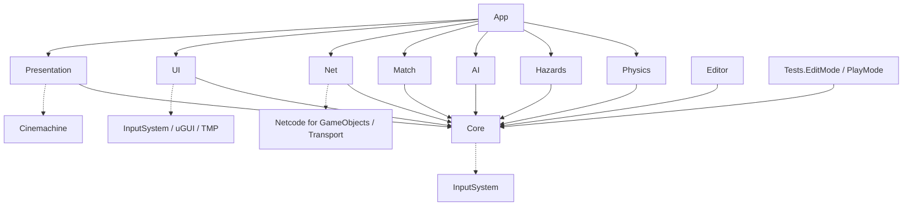

# Architecture

Design source: GDD 10 (technology and architecture) and 13.2. This page is the code-side map.

## Module map

| Assembly | Folder | Owner | Holds |
|---|---|---|---|
| `SquishyBump.Core` | `Scripts/Core` | both | contracts: `InputCommand`, events, interfaces, ScriptableObject types, seeded RNG, generated `SquishyControls` |
| `SquishyBump.Physics` | `Scripts/Physics` | Duy | `PlayerMotor`, `CollisionResolver`, `FighterProfileApplier` |
| `SquishyBump.Hazards` | `Scripts/Hazards` | Duy; `IceTiles/` Nhật | H01–H07 |
| `SquishyBump.AI` | `Scripts/AI` | Nhật | `BotBrain`, danger map, A* |
| `SquishyBump.Match` | `Scripts/Match` | Nhật | `MatchDirector`, rules, `ScoreService` |
| `SquishyBump.Net` | `Scripts/Net` | `Sync/` Duy, `Session/` Nhật | NGO session, input/snapshot sync, events |
| `SquishyBump.UI` | `Scripts/UI` | `Menus/` Duy, `HUD/` Nhật | screens |
| `SquishyBump.Presentation` | `Scripts/Presentation` | Duy | `RollVisual`, `CameraRig`, audio, VFX |
| `SquishyBump.App` | `Scripts/App` | both | composition root |
| `SquishyBump.Editor` | `Scripts/Editor` | Duy | `BuildScript`, `ProjectScaffold`, validators |

Each folder has an `AGENTS.md` with owner, invariants and related issues.

## Dependency graph

Rule (ADR-0003): gameplay modules reference **only Core** plus their Unity packages. Modules never
reference each other; they talk through Core interfaces and events that App wires together.
An exception needs an ADR with an `Allowed-Reference: A -> B` line. `tools/check_repo.py` enforces this.

## Authority model (GDD 10.4)

- The **host** simulates everything at a fixed 60 Hz: fighters, collisions, hazards, bots, rules, score.
- **Clients send `InputCommand`** (60 Hz) and receive snapshots (30 Hz, 100 ms interpolation buffer, GDD 6.1).
- Clients never write gameplay state. Presentation and UI run on every peer and only read state.
- **Host mode even in Single Player** (ADR-0002): Single Player starts NGO as host with bots, so the
  same code path is tested every day and M2 networking adds no rewrite.
- Randomness is seeded by the host (GDD 10.5).

## Hợp đồng chung (SB-06, hoàn thiện ở SB-07)

| Kiểu | Luồng sử dụng |
|---|---|
| `InputCommand` | Người chơi và bot dùng chung sequence, vector di chuyển XZ trước khi xoay theo camera, cờ nhảy/dash và yaw tính bằng độ. Constructor kẹp vector về độ dài 1 và đưa yaw về [0, 360), nên host dựng lại lệnh từ gói mạng là đã được kẹp. `HasValidValues` chỉ loại NaN và vô cực. `Jump`/`Dash` là trạng thái đang giữ ở tick đó, motor tự phát hiện cạnh nhấn. Host xử lý mỗi `Sequence` đúng một lần. GDD 10.4 quy định gửi 60 Hz, không tin cậy, lặp ba lệnh gần nhất. Core không tham chiếu Netcode, nên Net/Sync tự viết kiểu đóng gói riêng rồi dựng lại `InputCommand`. Kiểm tra thứ tự và hồi chiêu thuộc SB-21. |
| `IHostClock` | Đồng hồ mô phỏng của host. `Tick` tăng 1 mỗi `FixedUpdate` (60 Hz) chỉ khi đang host, bắt đầu từ 1 trong mỗi phiên, là 0 khi không host. `Ticked` phát sau khi tick tăng. Mọi `HostTick` trong event và mọi thời điểm hazard (GDD 10.5) lấy từ đây. |
| `HazardEvent` | `EventId`, `HostTick` (tick có hiệu lực), loại, và payload: `Index` (vòng, ô băng, pháo hoặc pusher thứ mấy), `Aim` (điểm ngắm của pháo), `Direction` (chiều quay mới của turntable). |
| `MatchEvent` | `EventId`, `HostTick`, loại, và payload: `FighterId`, `CreditedFighterId` (`NoFighter` khi rơi không ai chạm), `Value` (giây đếm ngược hoặc thứ hạng), `Standings` (kết quả trận, bảng điểm). Tạo bằng hàm tĩnh `Countdown`, `RingOut`, `Respawn`, `Elimination`, `MatchResult`, `Scoreboard`. |
| `IGameEvents`, `IGameEventSink` | Kênh event. Module nhận đăng ký `HazardRaised`/`MatchRaised` trên cả host lẫn client. Code chạy trên host lấy ID bằng `NextEventId()` rồi `Publish`. ID tăng dần trong phiên, bản có ID không lớn hơn ID cuối bị bỏ (idempotent theo GDD 10.4). |
| `ISessionService` | UI và luồng phiên gọi `Host`, `Join` hoặc `Leave`, rồi theo dõi `StateChanged`. Giá trị trả về của Host/Join báo thao tác có khởi động được. Trạng thái Joined xuất hiện sau khi NGO xác nhận kết nối. Trên host, `Peers`, `PeerJoined`, `PeerLeft` báo client từ xa (không tính host). `LastEndReason` cho biết vì sao phiên về Idle: `LocalLeave`, `ConnectFailed` hoặc `HostLost`. Relay (SB-70) sẽ thêm một hàm join riêng, không đổi các hàm hiện có. |

`GameplayBootstrap` trong Boot dựng service, là `IHostClock`, và giữ `GameEventHub` (bản chạy của kênh event).
Nó truyền input hợp lệ qua `IFighterMotor.Step` chỉ khi phiên đang host và NGO báo `IsHost`.
Tick và `EventId` bắt đầu lại khi phiên mở (Hosting) và khi phiên đóng (Idle).
Phần đồng bộ mạng (SB-23, SB-24) đăng ký kênh event trên host để gửi đi, và gọi `GameEventHub.Deliver` phía client.
`StubSessionService` gọi NGO `StartHost()` cho cả Single Player và LAN. Single Player lắng nghe trên loopback
với cổng tự cấp và từ chối client từ xa. LAN dùng cổng 7777. `StubMotor` giữ lệnh cuối và dịch
vị trí thử theo yaw trong một bước cố định. Menu, vòng lặp trận, PlayerMotor và quản lý lobby
sẽ nối vào các hợp đồng này trong các issue tiếp theo.

## Engine settings (verified by `EngineSettingsTests`)

| Setting | Value | Why |
|---|---|---|
| Fixed Timestep (`TimeManager.asset`) | 1/60 s | GDD 6.1 "Fixed physics step 60 Hz"; GDD 10.4 host runs physics at a fixed 60 Hz step |
| Gravity (`DynamicsManager.asset`) | (0, −20, 0) | GDD 6.1 "Game gravity g = 20 m/s²" (snappy jumps, about 2g) |
| Active Input Handling | Input System Package only | GDD 3.4 controls are Input Actions; GDD 10.2 engine choice |
| Run In Background | on | Not a GDD value: needed so several instances on one PC keep simulating during LAN tests (GDD 10.6 network gate, T06) |
| Company / Product / target | BKU Group 18 / Squishy Bump / Windows x64 standalone | GDD 15.3 members; GDD 10.1 "Windows 10 or 11 x64 downloadable executable" |
| Render pipeline | URP (PC asset) | GDD 10.2 |
| Asset serialization / meta files | Force Text / Visible Meta Files | GDD 13.5 team workflow, text merges |

## Scenes

### Phiên LAN và kiểm tra build (SB-20)

`StubSessionService` giữ tên để tương thích SB-06, thực hiện Host/Join bằng NGO và
UnityTransport. LAN mặc định UDP 7777, tối đa 6 người gồm host; Single Player nghe loopback
và từ chối client từ xa. Nhánh Rank gửi payload UTF-8 `SquishyBump-LAN-6:<Application.version>`.

và từ chối client từ xa. Client gửi payload UTF-8 `SquishyBump-LAN-7:<Application.version>`.
Host kiểm tra độ dài tối đa 128 byte và so khớp chính xác trước khi cấp slot; chưa có xác thực
tài khoản hoặc Relay. Khi thay wire format phải đổi revision Protocol trên tất cả peer.

Host trả mã từ chối `SB:VersionMismatch` hoặc `SB:RoomFull` qua approval response của NGO.
Client đọc `DisconnectReason` trong disconnect callback, giữ nguyên mã đến khi về Idle;
UI đọc các lý do Core để báo sai build/phòng đầy/host không tới được/host rời.
`InvalidAddress` báo ngay khi IPv4/port không hợp lệ; `StartFailed` khi NGO không mở được kết nối.
Hợp đồng `ISessionService` chỉ thêm giá trị enum và port mặc định, không thêm quyền mô phỏng cho client.
Chưa xác nhận LAN nhiều PC hoặc các test mới cho tới khi Unity compile/PlayMode và build chạy được.
### Luật Rank và điểm session (SB-27)

`MatchDirector` giữ luồng Intro/Countdown/Playing/Result cho cả hai luật; constructor
giữ mặc định Survival để tương thích caller cũ. Rank lấy `RankRules.FromProfile` từ
BalanceProfile ở đầu match: 3 mạng, 120 tick chờ hồi sinh, 90 tick bảo vệ ở 60 Hz.
`RankRules` chỉ là bản chụp bất biến của dữ liệu SO, không phải bộ số mặc định thứ hai.
Model thuần có thể nhận cấu hình trong fixture để kiểm thử chính sách không cần scene.

Quả đang chờ hồi sinh vẫn tính vào số ứng viên thắng, nên một quả tạm còn trên sàn
không làm match kết thúc sớm. Khi cửa sổ đóng (L1: tick ứng với lần rụng vành thứ ba;
L2–L5: time limit), các lượt chờ chưa đặt lại được bị kết thúc. Ring-out cùng tick chỉ
trừ một mạng, các lượt loại cùng tick chia hạng. Hết giờ Rank xét mạng còn rồi Wobble;
điểm đã ghi không bị mất. Mỗi tick sống chỉ tăng khi quả đang trên sàn, không tăng trong
thời gian chờ hồi sinh. Host chốt tổng mạng và thời gian sống một lần theo match ID.

`ScoreService` tồn tại qua các match trong LevelLauncher, cộng điểm cho người chạm
cuối trong cửa sổ 3 s (gồm biên đúng 3 s), bỏ tự chạm/chạm ngoài roster, chống ghi trùng
theo tick và nạn nhân. `CollisionResolver.Contact` báo mọi tiếp xúc, kể cả dưới ngưỡng
30 N·s; `Hit` vẫn chỉ phục vụ Wobble/stun/feedback. Sau khi hồi sinh, credit cũ được xóa.
Session xếp tổng điểm → tổng mạng còn → tổng tick sống; bằng cả ba thì đồng hạng.

App đặt lại bằng RespawnPicker đã có từ SB-28, kiểm tra raycast còn sàn dưới điểm chọn,
loại vùng hazard/collider hộp và reset vận tốc, input buffer, dash/stun, Wobble. Không có
điểm an toàn thì giữ chờ trong cửa sổ, không chọn một spawn nguy hiểm. Core chỉ thêm
interface đọc `IHazardZones`; Cannons trả vùng cảnh báo/đang tác động. Nón gió được bao
bằng hình tròn bảo thủ để chọn spawn, không thay hình/công thức nón trong gameplay.

Trong 1.5 s bảo vệ, motor vẫn nhận điều khiển và va chạm sàn; quả không tham gia
va chạm quả-quả, không nhận impulse/Wobble từ hazard. Tự đi khỏi sàn vẫn là ring-out.
Hiển thị chớp tối đa 2 Hz; chỉ toggle renderer vốn bật lúc spawn, không bật lại sphere
placeholder ẩn. Snapshot giữ số mạng và cờ Respawning/Invulnerable; event Rank dùng kênh
reliable của PR #99. Scoreboard mang điểm/mạng/tick sống và gồm cả quả chờ hồi sinh;
result không được bỏ quả duy nhất còn quyền chơi dù đang chờ. ResetForRespawn đặt cả
Transform và Rigidbody trước khi bật lại đối tượng để PhysX không khôi phục pose cũ.
LAN và dữ liệu cuối session vẫn phải kiểm tra qua các issue liên quan.

Unity đã sinh meta và chạy Native, gồm regression result/respawn đã tái hiện lỗi trước
khi sửa; bằng chứng cuối trong `docs/testing.md`. T05 toàn run Rank L1–L5 và T07 đủ
năm scene vẫn chưa đạt chỉ từ các ca chính sách và physics L1 này.

### Khung bot D1 (SB-18)

`AI/BotBrain` nhận mẫu cảm nhận bất biến từ App và trả `InputCommand`; không tham chiếu
Physics/Match/Net hoặc ghi Rigidbody. App chạy bot chỉ khi host và chuyển lệnh vào cùng
`GameplayBootstrap.TrySimulate`/PlayerMotor như người chơi. Mỗi bot có RNG theo seed và ID.
FSM có Countdown, Roam, Chase, Charge, Evade, Recover, Eliminated; D1 đọc BotProfile
(4 Hz, phản xạ 0.5 s, margin 0.5 m, aim noise 25°, alignment 35°, speed factor 0.85).
Cảm nhận được xếp hàng để dùng mẫu cũ theo reaction delay, chọn mục tiêu ngẫu nhiên mỗi 4 s;
anti-stuck khi tiến dưới 0.5 m trong 2 s về Roam với điểm an toàn ngẫu nhiên. Chưa triển khai
danger grid/A*/utility ở đây (SB-46). H01 được App đưa vào bán kính an toàn từ khi telegraph.

`MatchSetup.defaultBotProfile` đã nối tới `Data/Bots/D1.asset` qua Editor API
`ProjectScaffold.ConfigureBotDefaults`. Entry này chỉ điền slot trống của MatchSetup,
không dựng lại toàn bộ prefab. Unity đã sinh meta; Native 171 EditMode và 37 PlayMode
đạt, gồm ca năm bot di chuyển bằng PlayerMotor trên L1 và bị loại khi rơi. Bằng chứng
build và giới hạn nghiệm thu nằm ở `docs/testing.md`; chưa coi AI-1–AI-6/T13 đạt.

### L1 Training Ring (SB-14)

Scene L1 có bốn collider độc lập, mỗi collider ứng với một dải sàn rộng 3 m.
Sáu điểm spawn đánh dấu vị trí trên mặt sàn. Hệ thống spawn cộng độ cao theo
bán kính quả khi tạo fighter. Các sphere trong scene chỉ dùng để xem trước.

`MatchDirector` đăng ký `RingOut` khi nhận `TrainingRingBounds` của scene.
Sau bước mô phỏng, host cập nhật Wobble và gọi `SampleArena` cho các fighter
còn sống, rồi gọi `CompleteTick` đúng một lần. Sự kiện giữ ID, tick và lý do
rơi. Director gom toàn bộ lượt rơi theo tick rồi mới xếp hạng.
Khởi động lại Survival giữ level, roster và seed, đồng thời xóa các ring-out
cũ. Session điều phối việc nạp scene tiếp theo dựa trên `SurvivalOutcome`.

### Trình tự Survival (SB-16)

Intro → Countdown 3 giây → Playing → Result. Các thời lượng được cấp qua
constructor. Host cấp nhịp 60 Hz và tín hiệu quyền mô phỏng, có thể nối từ
`ISessionService.CanSimulateGameplay` khi SB-06 được tích hợp. Các tick trong
Intro và Countdown không làm tăng đồng hồ trận.

Khi còn tối đa một fighter, host chờ 30 tick kể từ lần loại cuối và vẫn nhận
ring-out trong thời gian đó. Khi còn nhiều fighter tại giới hạn giờ, host lấy
Wobble hiện tại để xếp hạng. Với L1, SB-15 sẽ làm vành cuối rụng ở giây 135
để kích hoạt ring-out qua scene. Giới hạn 150 giây là chốt dự phòng nếu sàn
không phát sinh thêm lượt rơi. Menu, tiến trình session và luật Rank sẽ được
nối trong các issue tương ứng.

`Scenes/Boot` (build index 0), `MainMenu`, `Lobby`, `Levels/L1…L5` are shared: edited by their owner
(L1, L4, L5 Nhật; L2, L3 Duy) or through prefabs. `Scenes/Sandbox/Test_Duy` and `Test_Nhat` are personal and
never built. Scene list is set by `SquishyBump.Editor.ProjectScaffold.Run`.

## H06 / SB-44

`Core.IceProfile` chứa balance GDD 7.4–7.5; `Hazards.IceRules` chụp dữ liệu thành tick.
`IceField` sở hữu RNG theo seed trận, trạng thái ô và BFS lục giác. Các ô đang nứt
được dự trữ cùng nhóm trước khi chọn tiếp, nên khi nhóm rụng vẫn còn ≥37 ô liên thông.
Ô hồi chỉ trở lại Solid sau fade, có hàng xóm Solid và không overlap quả.

`IceTiles` tạo mesh prism 2 m và PhysicsMaterial μ từ BalanceProfile, chỉ host gọi
Step/chọn ô/quyết định collider. App truyền seed và replay `IceTileWarning` (HostTick là lúc
rơi), `IceTileFading`, `IceTileSolid` theo thời gian GO của host. Hai event mới nối cuối
enum, không đổi số event cũ. Client không tự quyết định ô đã đứng được khi hết 10 giây.
Snapshot/catch-up và kiểm thử LAN đầy đủ còn phải đối chiếu SB-24; chưa kiểm chứng.

Editor menu `Squishy Bump/Build Level L4 (Frost Ring)` tạo SO/scene qua Unity API.
Editor Native đã tạo IceProfile.asset, scene L4 và meta. Mesh/collider được tạo ở Awake;
MaterialPropertyBlock cũng phải khởi tạo ở Awake, không ở field initializer khi Unity deserialize.
Protocol LAN-7 từ chối peer cũ không biết hai loại sự kiện mới. Revision này riêng nhánh
SB-44; khi tích hợp các PR song song phải giữ toàn bộ hợp đồng và chọn revision chung mới.
Kiểm thử collider và thuật toán không thay thế kiểm tra hình ảnh/cảnh báo trên Windows player.

Replay H06 lưu các chuyển trạng thái của cả match, kể cả các chu kỳ cũ. Client
chọn trạng thái theo đúng thời gian đang render, hỗ trợ nội suy lùi nhẹ. Nhận Solid
và Warning của chu kỳ tiếp theo cùng tick không được xóa Fading của tick trước đó.
Lịch sử sống trong scene match tối đa 150 s; đổi scene giải phóng cùng IceTiles.

## L5 Chaos Core / SB-45

`IceSceneBuilder.BuildL5` dùng chung đường dựng sàn/bounds/spawn của L4, bật chế độ
chaos trên IceTiles và Cannons. L5 dùng cùng IceProfile/BalanceProfile/HazardProfile;
không chép lại thuật toán H06, lực gió hoặc đạn đạo. Hai mount: Air 270° (tây,
x=-9.9), Fire 90° (đông, x=+9.9). Mỗi pháo có chu kỳ 4 s từ HazardProfile;
giữ cơ chế stagger 1.25 s hiện có của Cannons. Sóng ô 3.5 s, 2 ô trước 45 s,
3 ô sau đó từ IceRules.FromProfile(chaos:true). Không có MovingGround hoặc RingDrop.
Không đổi Core/App hay hợp đồng mạng so với nhánh phụ thuộc SB-44.

# SB-24 — đồng bộ sự kiện trận (đang triển khai, 21/11/2026)

`SB.Match` dùng NGO `ReliableSequenced`, chỉ host gửi. NetSync từ chối nguồn khác
ServerClientId và payload >512 byte. Codec chứa EventId, HostTick, loại, fighter,
last toucher và tối đa 6 dòng (ID, rank, points, lives, survivalTicks); một bảng 6
dòng là 174 byte trước prefix độ dài. Client không tính lại điểm hoặc thứ hạng.
Codec từ chối sai chiều dài, enum lạ, trường không dùng, ID trùng trong bảng, rank
không hợp lệ, điểm âm hoặc mạng ngoài 0–3. PR #99 dùng LAN-2; nhánh Rank nối tiếp
dùng LAN-6 để phân biệt build có các cờ/hành vi Rank, không trộn với Lobby LAN-3/HUD LAN-5.

GameplayBootstrap nối host EventHub → NetSync và NetSync client → EventHub, dùng
high-water EventId theo stream để bỏ bản nhận trùng/cũ. `MatchReplica` giữ bản đọc
cho UI trên cả hai peer, reset khi bắt đầu phiên/match mới, không mô phỏng luật.
`MatchStanding` sao chép danh sách khi tạo payload để caller không sửa kết quả đã phát.

MatchDirector Survival phát countdown 3/2/1/GO, ring-out, elimination (giữ shared
rank), scoreboard và kết quả đã xác nhận. Overlay hiển thị trực tiếp các dòng host;
client ẩn quả out và chờ respawn/snapshot mới. LevelLauncher đợi NGO báo hoàn tất
load scene trước khi cho host bắt đầu intro/countdown, tránh bắt đầu event khi
client còn tải sàn. Nhánh SB-27 nối Rank/ScoreService vào các event này;
codec và producer Rank đã qua Native, chưa có nghiệm thu full run Rank hoặc LAN nhiều PC.

Native verify đã đạt 176 EditMode/37 PlayMode, gồm hai NGO peer loopback truyền sáu
event và result lặp, so sánh replica/overlay. Chưa chạy LAN riêng máy, scene-load
barrier nhiều PC hoặc Rank tích hợp; không suy rộng test protocol thành nghiệm thu đó.

## SB-46 — cảm nhận sàn, danger map, A* và utility

Core.BotNavigation định nghĩa ảnh chụp IBotNavigationSnapshot, BotTerrainCell và
BotHazardWarning; các hazard triển khai IBotHazardHints chỉ đọc trạng thái đã cảnh
báo/đang tác động. App.BotNavigationWorld raycast lưới 1 m (tối đa 26×26), loại layer
Fighter và ô ngoài arena, nhận collider H06 để gắn cờ băng. Ô rơi/fade không có
collider nên không đứng được. Khoảng cách mép lấy min của biên tròn và biên các ô
lưới không có sàn; đây là xấp xỉ theo độ phân giải 1 m, không phải navmesh liên tục.
Ảnh chụp được chia sẻ cho các bot; mỗi bot giữ dữ liệu theo reaction delay của profile.
AI không tìm scene singleton, không gọi vật lý hoặc ghi Transform/Rigidbody.

DangerMap lấy max của mép và các vùng telegraph có trong awareness, dùng đúng
1−τ/2 s, clamp [0,1]; margin băng ×1.5 theo dữ liệu profile từ D3. RingDrop cấp vành
đang báo; H06 cấp ô đang nứt; Cannons cấp cone khí, marker khi đạn đã bay và vùng
cháy; MovingGround cấp cảnh báo đổi chiều/hộp đang thấy; PusherBlocks cấp làn đã
có lịch xuất bến. Không lộ điểm rơi H05 trước lúc marker hiện. TimeToImpact cho phép
hint hộp ở vị trí dự đoán 1 s từ chuyển động nhìn thấy; chưa chứng minh toàn bộ chiến
thuật D5 của SB-47 bằng hint này.

GridPathfinder dùng heap tái sử dụng, tám hàng xóm, cost vào ô 1+8D, không cắt góc
qua ô bị chặn. Heuristic Euclid/sqrt(2) là cận dưới phù hợp vì bước chéo cũng cost 1;
không tăng giá bước chéo hoặc đổi công thức GDD. Replan ở mỗi quyết định di chuyển,
giữ waypoint giữa các quyết định và điều khiển theo vị trí bản thân hiện tại. Dữ liệu
đối thủ/hazard vẫn theo ảnh chụp cảm nhận trễ. Hướng nhìn đuổi mục tiêu tách khỏi
hướng di chuyển theo path; InputCommand đổi vector thế giới về hệ yaw-local như trước.

Utility theo đúng A.3, xét đường tới mục tiêu, Wobble và khối lượng tương đối; không
có cờ ưu tiên người thật. Giữ mục tiêu trừ khi ứng viên hơn ít nhất 0.15 (có xử lý
sai số float tại biên); U<0.4 quay về Roam. D1 vẫn chọn ngẫu nhiên mỗi 4 s. Điểm tiếp
cận ở phía xa mép của nạn nhân. Evade chọn ô an toàn tới được, cost rẻ nhất trong
4 m bằng một lượt Dijkstra cùng graph/cost; anti-stuck chỉ chấp nhận mục tiêu ngẫu
nhiên có đường tới. BotBrain chỉ xuất InputCommand, host vẫn dùng PlayerMotor và
CollisionResolver hiện hữu. Hợp đồng mạng LAN-7 giữ nguyên từ nhánh phụ thuộc.

SB-47 còn phải nối/kiểm chứng đầy đủ hành vi D1–D5, jump, xử lý băng, chiến thuật
hạng cân, AI-1–AI-6 và profiler. SB-46 không chứng minh các kịch bản đó đã đạt.

## SB-17 — sửa bố cục Wobble theo review, 23/11/2026

Giữ anchor HUD cố định; Wobble bám khung model trên màn hình, pivot đáy và nâng
nhãn để tránh hình quả/chữ khác. Cache renderer, tái dùng danh sách tối đa sáu nhãn.
UI chỉ đọc trạng thái, không đổi gameplay. Hợp đồng tích hợp trên nền main a7b1656
là LAN-10 sau tích hợp lobby c534179: giữ Lives/Rank của main và DashCooldownTicks của SB-17 trong snapshot
225 byte/sáu quả; từ chối build revision cũ. Xem báo cáo hình ảnh tại
[SB-17 Windows player](testing/sb17-hud-review/README.md).
# Lobby SB-25 đang nối tiếp PR #95

Base `ea46852` cung cấp LobbyRoom host-owned và greybox LOB01. Phần nối tiếp dùng
Core `LobbyState` bất biến và `ILobbyChannel`, Net.Session `LobbyCodec`/`LobbySync`
(reliable sequenced), App `LobbyCoordinator`. Client không gửi lựa chọn fruit hoặc
rule/Lk: việc claim phải do adapter kiểm tra vị trí trên host. Client gửi một byte
ready và sender ID lấy từ NGO. Codec từ chối hai người cùng fruit, ID trùng, ready
chưa chọn fruit hoặc countdown khi chưa đủ hai người ready.

Coordinator theo dõi join/leave và clock host, phát countdown một lần mỗi giây và
StartRequested đúng một lần. Peer rời giải phóng fruit/cancel countdown; dispose
tháo mọi handler. Client chỉ thay bản đọc khi revision mới hơn. Bootstrap poll
LobbySync suốt phiên để handler sẵn trước khi scene lobby hoạt động.
Revision LAN của nhánh này là 3 để từ chối build main cũ chưa hiểu lobby. Nhánh
SB-24 dùng revision 2 cho match event; khi tích hợp cả hai và snapshot SB-17 phải
chọn revision mới chung, không để hai wire format khác nhau cùng revision.

LobbyController tạo avatar trung tính hoặc prefab trái đã chọn, gửi input qua
NetSync, host dùng InputInbox/PlayerMotor và snapshot 30 Hz, client nội suy bằng
SnapshotBuffer. Chỉ host xét tâm quả trong pick volume rồi claim. Không gửi lệnh
claim từ client. Host phải tới gần desk mới đổi rule/Lk; info/controls dùng canvas
world-space, nút ready/leave và desk ở overlay. LobbyProfile chứa vị trí spawn,
class mặc định, khoảng cách desk và countdown 5 giây; Editor scaffold gán SO.

Bootstrap giữ LobbySelection qua scene, LevelLauncher tạo roster theo ID/fruit
đã xác nhận (LAN không thêm bot/idle), Single chọn trái đầu rồi đủ năm trái còn lại.
Single luôn đi qua lobby tới L1; nút chọn tắt màn và nút Start bỏ qua ready đã gỡ.
Progression Lk ở các trận sau thuộc tích hợp SB-26/SB-29, chưa được chứng minh.
Native verify đạt 179 EditMode/37 PlayMode, gồm input đi lại qua NGO, chọn/khóa trái,
quầy host theo vị trí, info, ready/countdown và roster hai người. LobbySync kiểm tra
`reader.Length - reader.Position`: NGO đã đọc hash tên message trước handler.
Chưa duyệt hình ảnh/glyph trong Windows player hoặc LAN nhiều PC; xem `docs/testing.md`.
PR nối tiếp lấy base `feat/SB-25-lobby-foundation`; merge #95 trước, sau đó merge
origin/main vào nhánh nối tiếp, chuyển base PR về main và verify lại; không force-push
hoặc tự merge PR để đổi việc.

## SB-26 — luồng Single và roster theo seed

Match.SinglePlayerRun giữ seed run, bậc/seed từng màn, số lần retry và số màn đã
qua. Một lần shuffle năm slot nhân vật còn lại sau lựa chọn lobby; ID bot/nhân vật
không đổi giữa các màn. Theo A.6, màn N có một D_N và bốn lần rút đều trong
[max(1,N−2),N]. D39 thay hình trái bằng thú nhưng giữ slot và hạng cân.

App.LevelLauncher nối lobby → L1, kết quả host → Chơi lại/Tiếp tục, L5 → tổng kết.
Survival chỉ đi tiếp khi người chơi hạng nhất duy nhất; Rank đi tiếp kể cả thua.
Retry nạp lại scene bằng seed/roster cũ để tạo lại sàn, hazard, motor và BotBrain.
UI chỉ nhận dữ liệu và callback; giữ thời gian đọc kết quả tối thiểu 3 s. Trận dừng
mô phỏng sau Result; nhấp tiếp tục lặp khi đang tải không được nhảy hai màn.
ScoreService hiện hữu giữ tổng Rank qua các màn. API StartSinglePlayer(n)/LoadLevel(n)
vẫn dành cho test/công cụ; đường menu production luôn bắt đầu L1 và không có chọn tắt màn.

MatchSetup tham chiếu D1–D5 có sẵn qua Editor.SinglePlayerSetup.Configure;
ProjectScaffold gọi cùng helper. Không đổi wire protocol hoặc Core contract.
Giới hạn kiểm chứng T04 và lệnh chạy lại: [báo cáo SB-26](testing/sb26-single-run.md).

## SB-30 — ngắt kết nối & đóng/mở nhận người

`StubSessionService.AcceptingPlayers` (mặc định bật, reset khi `Host`) trả `SessionEndReason.MatchInProgress`
(`"SB:MatchInProgress"`) khi phòng đang đấu. `MatchHost.StartMatch` gọi `GameplayBootstrap.LockLanRoster`,
còn `LevelLauncher` mở lại qua `UnlockLanRoster` khi nạp `Lobby`.

`MatchHost` nhận `PeerLeft`, xoá input inbox, dừng motor/collider/force adapter ngay và đưa
`ReportDisconnect` vào host tick kế tiếp. `MatchDirector` loại trực tiếp ở tick đó cho cả
Survival và Rank (kể cả khi đang chờ hồi sinh: hết mạng, không respawn, không tính ring-out/last-touch
credit, giữ nguyên điểm đã ghi), ghi `DisconnectedAt` và chỉ phát một `MatchEvent.Elimination`.

### SB-32 — UI kết quả và spectator

`MatchHost` nhận reliable `MatchEvent.Scoreboard`/result, giữ nguyên rank/points/lives
host gửi và chuyển cho `MatchHud.SetStandings`. Snapshot không xếp lại hạng/điểm;
`ViewSpawned` chỉ resolve tên/màu từ prefab/snapshot. Trên client, Fruit lấy theo
ID trong snapshot thay vì coi peer ID là slot prefab (ID sau reconnect có thể khác).
`LocalPlayerInput.ScoreboardHeld` đọc action Scoreboard; App bật/tắt bảng khi giữ/thả,
không dừng clock/motor. UI chỉ trình bày dữ liệu.

Camera dùng cùng `CameraRig.Follow` cho hai luật: Rank còn mạng giữ target cục bộ
khi ẩn chờ respawn; khi thật sự bị loại thì theo fighter sống và đổi trái/phải.
Trang kết quả match/session giữ hạng host, podium/top3/điểm/mạng, các hạng còn lại
và delay ít nhất 3 giây unscaled. HUD gameplay ẩn trong kết quả. Không đổi Core
contract, packet hay simulation ownership.
# SB-50 — tutorial L1 đang triển khai

Core TutorialProfile giữ bố trí marker/đồ chơi; Match.TutorialFlow giữ bước và chỉ
chấp nhận bằng chứng từ host. App.TutorialSession nối InputCommand → PlayerMotor
và CollisionResolver giống gameplay, nhưng không tạo MatchDirector, score hay bot.
UI.TutorialPanel chỉ hiển thị và gửi yêu cầu bỏ qua/đóng thẻ class. Không đọc thiết bị
ngoài LocalPlayerInput. Toy dùng collider không scale và cùng thông số class để
resolver xử lý xung lực; không thuộc roster sáu quả hoặc bảng điểm.

MatchHost giữ StartMatch cho đến khi bài tập kết thúc, gỡ mọi đối tượng tập rồi tạo
roster mới. Do đó vị trí, vận tốc, cooldown, stun và Wobble không truyền sang match.
Clock host tiếp tục chạy nhưng thời gian Playing của Director/hazard chưa bắt đầu.
Rơi trong lúc tập reset motor tại điểm tập, giữ bước và xoá trạng thái nhảy dở dang.

SaveData bổ sung TutorialCompleted/TutorialSkipped mặc định false, không đổi cấu
trúc cũ; bỏ qua lưu lựa chọn riêng và không coi là hoàn thành đủ năm bước. Editor
ProjectScaffold tạo profile và gán MatchSetup qua SerializedObject. Source chưa
được Unity import; cần tích hợp SB-18 để năm bot D1 thực sự hoạt động sau tutorial.
