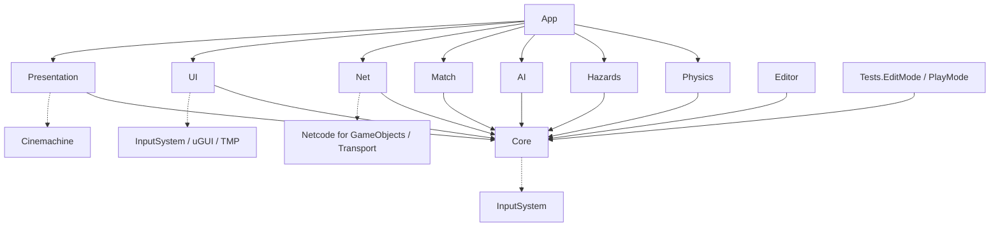

# Architecture

Design source: GDD 10 (technology and architecture) and 13.2. This page is the code-side map.

## Module map

| Assembly | Folder | Owner | Holds |
|---|---|---|---|
| `SquishyBump.Core` | `Scripts/Core` | both | contracts: `InputCommand`, events, interfaces, ScriptableObject types, seeded RNG, generated `SquishyControls` |
| `SquishyBump.Physics` | `Scripts/Physics` | Duy | `PlayerMotor`, `CollisionResolver`, `FighterProfileApplier` |
| `SquishyBump.Hazards` | `Scripts/Hazards` | Duy; `IceTiles/` Nhật | H01–H07 |
| `SquishyBump.AI` | `Scripts/AI` | Nhật | `BotBrain`, danger map, A* |
| `SquishyBump.Match` | `Scripts/Match` | Nhật | `MatchDirector`, rules, `ScoreService` |
| `SquishyBump.Net` | `Scripts/Net` | `Sync/` Duy, `Session/` Nhật | NGO session, input/snapshot sync, events |
| `SquishyBump.UI` | `Scripts/UI` | `Menus/` Duy, `HUD/` Nhật | screens |
| `SquishyBump.Presentation` | `Scripts/Presentation` | Duy | `RollVisual`, `CameraRig`, audio, VFX |
| `SquishyBump.App` | `Scripts/App` | both | composition root |
| `SquishyBump.Editor` | `Scripts/Editor` | Duy | `BuildScript`, `ProjectScaffold`, validators |

Each folder has an `AGENTS.md` with owner, invariants and related issues.

## Dependency graph

Rule (ADR-0003): gameplay modules reference **only Core** plus their Unity packages. Modules never
reference each other; they talk through Core interfaces and events that App wires together.
An exception needs an ADR with an `Allowed-Reference: A -> B` line. `tools/check_repo.py` enforces this.

## Authority model (GDD 10.4)

- The **host** simulates everything at a fixed 60 Hz: fighters, collisions, hazards, bots, rules, score.
- **Clients send `InputCommand`** (60 Hz) and receive snapshots (30 Hz, 100 ms interpolation buffer, GDD 6.1).
- Clients never write gameplay state. Presentation and UI run on every peer and only read state.
- **Host mode even in Single Player** (ADR-0002): Single Player starts NGO as host with bots, so the
  same code path is tested every day and M2 networking adds no rewrite.
- Randomness is seeded by the host (GDD 10.5).

## Engine settings (verified by `EngineSettingsTests`)

| Setting | Value | Why |
|---|---|---|
| Fixed Timestep (`TimeManager.asset`) | 1/60 s | GDD 6.1 "Fixed physics step 60 Hz"; GDD 10.4 host runs physics at a fixed 60 Hz step |
| Gravity (`DynamicsManager.asset`) | (0, −20, 0) | GDD 6.1 "Game gravity g = 20 m/s²" (snappy jumps, about 2g) |
| Active Input Handling | Input System Package only | GDD 3.4 controls are Input Actions; GDD 10.2 engine choice |
| Run In Background | on | Not a GDD value: needed so several instances on one PC keep simulating during LAN tests (GDD 10.6 network gate, T06) |
| Company / Product / target | BKU Group 18 / Squishy Bump / Windows x64 standalone | GDD 15.3 members; GDD 10.1 "Windows 10 or 11 x64 downloadable executable" |
| Render pipeline | URP (PC asset) | GDD 10.2 |
| Asset serialization / meta files | Force Text / Visible Meta Files | GDD 13.5 team workflow, text merges |

## Scenes

### L1 Training Ring (SB-14)

Scene L1 có bốn collider độc lập, mỗi collider ứng với một dải sàn rộng 3 m.
Sáu điểm spawn đánh dấu vị trí trên mặt sàn. Hệ thống spawn cộng độ cao theo
bán kính quả khi tạo fighter. Các sphere trong scene chỉ dùng để xem trước.

`MatchDirector` đăng ký `RingOut` khi nhận `TrainingRingBounds` của scene.
Sau bước mô phỏng, host cập nhật Wobble và gọi `SampleArena` cho các fighter
còn sống, rồi gọi `CompleteTick` đúng một lần. Sự kiện giữ ID, tick và lý do
rơi. Director gom toàn bộ lượt rơi theo tick rồi mới xếp hạng.
Khởi động lại Survival giữ level, roster và seed, đồng thời xóa các ring-out
cũ. Session điều phối việc nạp scene tiếp theo dựa trên `SurvivalOutcome`.

### Trình tự Survival (SB-16)

Intro → Countdown 3 giây → Playing → Result. Các thời lượng được cấp qua
constructor. Host cấp nhịp 60 Hz và tín hiệu quyền mô phỏng, có thể nối từ
`ISessionService.CanSimulateGameplay` khi SB-06 được tích hợp. Các tick trong
Intro và Countdown không làm tăng đồng hồ trận.

Khi còn tối đa một fighter, host chờ 30 tick kể từ lần loại cuối và vẫn nhận
ring-out trong thời gian đó. Khi còn nhiều fighter tại giới hạn giờ, host lấy
Wobble hiện tại để xếp hạng. Với L1, SB-15 sẽ làm vành cuối rụng ở giây 135
để kích hoạt ring-out qua scene. Giới hạn 150 giây là chốt dự phòng nếu sàn
không phát sinh thêm lượt rơi. Menu, tiến trình session và luật Rank sẽ được
nối trong các issue tương ứng.

`Scenes/Boot` (build index 0), `MainMenu`, `Lobby`, `Levels/L1…L5` are shared: edited by their owner
(L1, L4, L5 Nhật; L2, L3 Duy) or through prefabs. `Scenes/Sandbox/Test_Duy` and `Test_Nhat` are personal and
never built. Scene list is set by `SquishyBump.Editor.ProjectScaffold.Run`.
