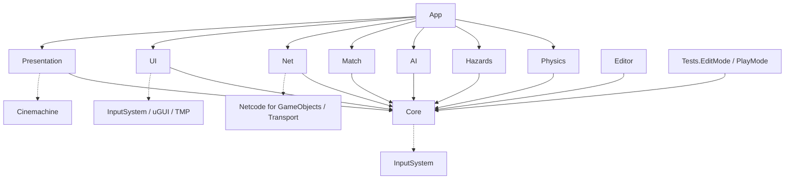

# Architecture

Design source: GDD 10 (technology and architecture) and 13.2. This page is the code-side map.

## Module map

| Assembly | Folder | Owner | Holds |
|---|---|---|---|
| `SquishyBump.Core` | `Scripts/Core` | both | contracts: `InputCommand`, events, interfaces, ScriptableObject types, seeded RNG, generated `SquishyControls` |
| `SquishyBump.Physics` | `Scripts/Physics` | Duy | `PlayerMotor`, `CollisionResolver`, `FighterProfileApplier` |
| `SquishyBump.Hazards` | `Scripts/Hazards` | Duy; `IceTiles/` Nhật | H01–H07 |
| `SquishyBump.AI` | `Scripts/AI` | Nhật | `BotBrain`, danger map, A* |
| `SquishyBump.Match` | `Scripts/Match` | Nhật | `MatchDirector`, rules, `ScoreService` |
| `SquishyBump.Net` | `Scripts/Net` | `Sync/` Duy, `Session/` Nhật | NGO session, input/snapshot sync, events |
| `SquishyBump.UI` | `Scripts/UI` | `Menus/` Duy, `HUD/` Nhật | screens |
| `SquishyBump.Presentation` | `Scripts/Presentation` | Duy | `RollVisual`, `CameraRig`, audio, VFX |
| `SquishyBump.App` | `Scripts/App` | both | composition root |
| `SquishyBump.Editor` | `Scripts/Editor` | Duy | `BuildScript`, `ProjectScaffold`, validators |

Each folder has an `AGENTS.md` with owner, invariants and related issues.

## Dependency graph

Rule (ADR-0003): gameplay modules reference **only Core** plus their Unity packages. Modules never
reference each other; they talk through Core interfaces and events that App wires together.
An exception needs an ADR with an `Allowed-Reference: A -> B` line. `tools/check_repo.py` enforces this.

## Authority model (GDD 10.4)

- The **host** simulates everything at a fixed 60 Hz: fighters, collisions, hazards, bots, rules, score.
- **Clients send `InputCommand`** (60 Hz) and receive snapshots (30 Hz, 100 ms interpolation buffer, GDD 6.1).
- Clients never write gameplay state. Presentation and UI run on every peer and only read state.
- **Host mode even in Single Player** (ADR-0002): Single Player starts NGO as host with bots, so the
  same code path is tested every day and M2 networking adds no rewrite.
- Randomness is seeded by the host (GDD 10.5).

## Hợp đồng chung của SB-06

| Kiểu | Luồng sử dụng |
|---|---|
| `InputCommand` | Người chơi và bot dùng chung sequence, vector di chuyển XZ trước khi xoay theo camera, cờ nhảy/dash và yaw tính bằng độ. Host kiểm tra vector hữu hạn có độ dài tối đa 1 và yaw hữu hạn trước khi đưa vào motor. GDD 10.4 quy định gửi 60 Hz, không tin cậy, lặp ba lệnh gần nhất. Đóng gói, kiểm tra thứ tự và hồi chiêu thuộc phần đồng bộ tiếp theo. |
| `HazardEvent`, `MatchEvent` | Header có loại sự kiện, `EventId` và `HostTick`. Host cấp ID duy nhất trong phiên, `HostTick` theo bước mô phỏng 60 Hz. Với hazard, tick là thời điểm hiệu lực. GDD yêu cầu phát tin cậy và dùng ID để bỏ sự kiện lặp. Payload từng loại, truyền và bỏ bản lặp thuộc phần đồng bộ tiếp theo. |
| `ISessionService` | UI và luồng phiên gọi `Host`, `Join` hoặc `Leave`, rồi theo dõi `StateChanged`. Giá trị trả về của Host/Join báo thao tác có khởi động được. Trạng thái Joined xuất hiện sau khi NGO xác nhận kết nối. |

`GameplayBootstrap` trong Boot dựng service và truyền input hợp lệ qua `IFighterMotor.Step`
chỉ khi phiên đang host và NGO báo `IsHost`. `StubSessionService` gọi NGO `StartHost()`
cho cả Single Player và LAN. Single Player lắng nghe trên loopback với cổng tự cấp
và từ chối client từ xa. LAN dùng cổng 7777. `StubMotor` giữ lệnh cuối và dịch
vị trí thử theo yaw trong một bước cố định. Menu, vòng lặp trận, PlayerMotor và quản lý lobby
sẽ nối vào các hợp đồng này trong các issue tiếp theo.

## Engine settings (verified by `EngineSettingsTests`)

| Setting | Value | Why |
|---|---|---|
| Fixed Timestep (`TimeManager.asset`) | 1/60 s | GDD 6.1 "Fixed physics step 60 Hz"; GDD 10.4 host runs physics at a fixed 60 Hz step |
| Gravity (`DynamicsManager.asset`) | (0, −20, 0) | GDD 6.1 "Game gravity g = 20 m/s²" (snappy jumps, about 2g) |
| Active Input Handling | Input System Package only | GDD 3.4 controls are Input Actions; GDD 10.2 engine choice |
| Run In Background | on | Not a GDD value: needed so several instances on one PC keep simulating during LAN tests (GDD 10.6 network gate, T06) |
| Company / Product / target | BKU Group 18 / Squishy Bump / Windows x64 standalone | GDD 15.3 members; GDD 10.1 "Windows 10 or 11 x64 downloadable executable" |
| Render pipeline | URP (PC asset) | GDD 10.2 |
| Asset serialization / meta files | Force Text / Visible Meta Files | GDD 13.5 team workflow, text merges |

## Scenes

### L1 Training Ring (SB-14)

Scene L1 có bốn collider độc lập, mỗi collider ứng với một dải sàn rộng 3 m.
Sáu điểm spawn đánh dấu vị trí trên mặt sàn. Hệ thống spawn cộng độ cao theo
bán kính quả khi tạo fighter. Các sphere trong scene chỉ dùng để xem trước.

Khi tích hợp SB-16, `MatchDirector` lấy `TrainingRingBounds` của scene đang
chạy, đăng ký `RingOut` và gọi `SampleOnHost(fighterId, hostTick, worldCenter)`
cho từng fighter còn sống sau bước mô phỏng. Sự kiện mang ID fighter, tick và
lý do rơi. MatchDirector áp luật Survival hoặc Rank. Sau khi hồi sinh, gọi
`ResetFighterOnHost(fighterId)` để lần rơi kế tiếp có thể được ghi nhận.
Lịch cảnh báo và rụng vành H01 thuộc SB-15.

`Scenes/Boot` (build index 0), `MainMenu`, `Lobby`, `Levels/L1…L5` are shared: edited by their owner
(L1, L4, L5 Nhật; L2, L3 Duy) or through prefabs. `Scenes/Sandbox/Test_Duy` and `Test_Nhat` are personal and
never built. Scene list is set by `SquishyBump.Editor.ProjectScaffold.Run`.
