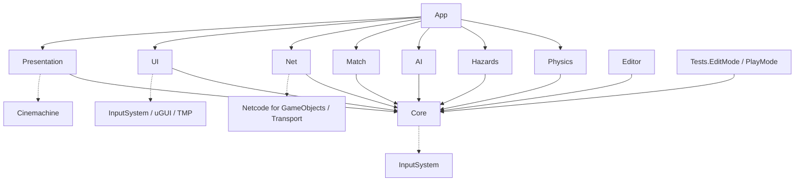

# Architecture

Design source: GDD 10 (technology and architecture) and 13.2. This page is the code-side map.

## Module map

| Assembly | Folder | Owner | Holds |
|---|---|---|---|
| `SquishyBump.Core` | `Scripts/Core` | both | contracts: `InputCommand`, events, interfaces, ScriptableObject types, seeded RNG, generated `SquishyControls` |
| `SquishyBump.Physics` | `Scripts/Physics` | Duy | `PlayerMotor`, `CollisionResolver`, `FighterProfileApplier` |
| `SquishyBump.Hazards` | `Scripts/Hazards` | Duy; `IceTiles/` Nhật | H01–H07 |
| `SquishyBump.AI` | `Scripts/AI` | Nhật | `BotBrain`, danger map, A* |
| `SquishyBump.Match` | `Scripts/Match` | Nhật | `MatchDirector`, rules, `ScoreService` |
| `SquishyBump.Net` | `Scripts/Net` | `Sync/` Duy, `Session/` Nhật | NGO session, input/snapshot sync, events |
| `SquishyBump.UI` | `Scripts/UI` | `Menus/` Duy, `HUD/` Nhật | screens |
| `SquishyBump.Presentation` | `Scripts/Presentation` | Duy | `RollVisual`, `CameraRig`, audio, VFX |
| `SquishyBump.App` | `Scripts/App` | both | composition root |
| `SquishyBump.Editor` | `Scripts/Editor` | Duy | `BuildScript`, `ProjectScaffold`, validators |

Each folder has an `AGENTS.md` with owner, invariants and related issues.

## Dependency graph

Rule (ADR-0003): gameplay modules reference **only Core** plus their Unity packages. Modules never
reference each other; they talk through Core interfaces and events that App wires together.
An exception needs an ADR with an `Allowed-Reference: A -> B` line. `tools/check_repo.py` enforces this.

## Authority model (GDD 10.4)

- The **host** simulates everything at a fixed 60 Hz: fighters, collisions, hazards, bots, rules, score.
- **Clients send `InputCommand`** (60 Hz) and receive snapshots (30 Hz, 100 ms interpolation buffer, GDD 6.1).
- Clients never write gameplay state. Presentation and UI run on every peer and only read state.
- **Host mode even in Single Player** (ADR-0002): Single Player starts NGO as host with bots, so the
  same code path is tested every day and M2 networking adds no rewrite.
- Randomness is seeded by the host (GDD 10.5).

## Hợp đồng chung (SB-06, hoàn thiện ở SB-07)

| Kiểu | Luồng sử dụng |
|---|---|
| `InputCommand` | Người chơi và bot dùng chung sequence, vector di chuyển XZ trước khi xoay theo camera, cờ nhảy/dash và yaw tính bằng độ. Constructor kẹp vector về độ dài 1 và đưa yaw về [0, 360), nên host dựng lại lệnh từ gói mạng là đã được kẹp. `HasValidValues` chỉ loại NaN và vô cực. `Jump`/`Dash` là trạng thái đang giữ ở tick đó, motor tự phát hiện cạnh nhấn. Host xử lý mỗi `Sequence` đúng một lần. GDD 10.4 quy định gửi 60 Hz, không tin cậy, lặp ba lệnh gần nhất. Core không tham chiếu Netcode, nên Net/Sync tự viết kiểu đóng gói riêng rồi dựng lại `InputCommand`. Kiểm tra thứ tự và hồi chiêu thuộc SB-21. |
| `IHostClock` | Đồng hồ mô phỏng của host. `Tick` tăng 1 mỗi `FixedUpdate` (60 Hz) chỉ khi đang host, bắt đầu từ 1 trong mỗi phiên, là 0 khi không host. `Ticked` phát sau khi tick tăng. Mọi `HostTick` trong event và mọi thời điểm hazard (GDD 10.5) lấy từ đây. |
| `HazardEvent` | `EventId`, `HostTick` (tick có hiệu lực), loại, và payload: `Index` (vòng, ô băng, pháo hoặc pusher thứ mấy), `Aim` (điểm ngắm của pháo), `Direction` (chiều quay mới của turntable). |
| `MatchEvent` | `EventId`, `HostTick`, loại, và payload: `FighterId`, `CreditedFighterId` (`NoFighter` khi rơi không ai chạm), `Value` (giây đếm ngược hoặc thứ hạng), `Standings` (kết quả trận, bảng điểm). Tạo bằng hàm tĩnh `Countdown`, `RingOut`, `Respawn`, `Elimination`, `MatchResult`, `Scoreboard`. |
| `IGameEvents`, `IGameEventSink` | Kênh event. Module nhận đăng ký `HazardRaised`/`MatchRaised` trên cả host lẫn client. Code chạy trên host lấy ID bằng `NextEventId()` rồi `Publish`. ID tăng dần trong phiên, bản có ID không lớn hơn ID cuối bị bỏ (idempotent theo GDD 10.4). |
| `ISessionService` | UI và luồng phiên gọi `Host`, `Join` hoặc `Leave`, rồi theo dõi `StateChanged`. Giá trị trả về của Host/Join báo thao tác có khởi động được. Trạng thái Joined xuất hiện sau khi NGO xác nhận kết nối. Trên host, `Peers`, `PeerJoined`, `PeerLeft` báo client từ xa (không tính host). `LastEndReason` cho biết vì sao phiên về Idle: `LocalLeave`, `ConnectFailed` hoặc `HostLost`. Relay (SB-70) sẽ thêm một hàm join riêng, không đổi các hàm hiện có. |

`GameplayBootstrap` trong Boot dựng service, là `IHostClock`, và giữ `GameEventHub` (bản chạy của kênh event).
Nó truyền input hợp lệ qua `IFighterMotor.Step` chỉ khi phiên đang host và NGO báo `IsHost`.
Tick và `EventId` bắt đầu lại khi phiên mở (Hosting) và khi phiên đóng (Idle).
Phần đồng bộ mạng (SB-23, SB-24) đăng ký kênh event trên host để gửi đi, và gọi `GameEventHub.Deliver` phía client.
`StubSessionService` gọi NGO `StartHost()` cho cả Single Player và LAN. Single Player lắng nghe trên loopback
với cổng tự cấp và từ chối client từ xa. LAN dùng cổng 7777. `StubMotor` giữ lệnh cuối và dịch
vị trí thử theo yaw trong một bước cố định. Menu, vòng lặp trận, PlayerMotor và quản lý lobby
sẽ nối vào các hợp đồng này trong các issue tiếp theo.

## Engine settings (verified by `EngineSettingsTests`)

| Setting | Value | Why |
|---|---|---|
| Fixed Timestep (`TimeManager.asset`) | 1/60 s | GDD 6.1 "Fixed physics step 60 Hz"; GDD 10.4 host runs physics at a fixed 60 Hz step |
| Gravity (`DynamicsManager.asset`) | (0, −20, 0) | GDD 6.1 "Game gravity g = 20 m/s²" (snappy jumps, about 2g) |
| Active Input Handling | Input System Package only | GDD 3.4 controls are Input Actions; GDD 10.2 engine choice |
| Run In Background | on | Not a GDD value: needed so several instances on one PC keep simulating during LAN tests (GDD 10.6 network gate, T06) |
| Company / Product / target | BKU Group 18 / Squishy Bump / Windows x64 standalone | GDD 15.3 members; GDD 10.1 "Windows 10 or 11 x64 downloadable executable" |
| Render pipeline | URP (PC asset) | GDD 10.2 |
| Asset serialization / meta files | Force Text / Visible Meta Files | GDD 13.5 team workflow, text merges |

## Scenes

### Phiên LAN và kiểm tra build (SB-20)

`StubSessionService` giữ tên để tương thích SB-06, thực hiện Host/Join bằng NGO và
UnityTransport. LAN mặc định UDP 7777, tối đa 6 người gồm host; Single Player nghe loopback
và từ chối client từ xa. Client gửi payload UTF-8 `SquishyBump-LAN-7:<Application.version>`.
Host kiểm tra độ dài tối đa 128 byte và so khớp chính xác trước khi cấp slot; chưa có xác thực
tài khoản hoặc Relay. Khi thay wire format phải đổi revision Protocol trên tất cả peer.

Host trả mã từ chối `SB:VersionMismatch` hoặc `SB:RoomFull` qua approval response của NGO.
Client đọc `DisconnectReason` trong disconnect callback, giữ nguyên mã đến khi về Idle;
UI đọc các lý do Core để báo sai build/phòng đầy/host không tới được/host rời.
`InvalidAddress` báo ngay khi IPv4/port không hợp lệ; `StartFailed` khi NGO không mở được kết nối.
Hợp đồng `ISessionService` chỉ thêm giá trị enum và port mặc định, không thêm quyền mô phỏng cho client.
Chưa xác nhận LAN nhiều PC hoặc các test mới cho tới khi Unity compile/PlayMode và build chạy được.

### L1 Training Ring (SB-14)

Scene L1 có bốn collider độc lập, mỗi collider ứng với một dải sàn rộng 3 m.
Sáu điểm spawn đánh dấu vị trí trên mặt sàn. Hệ thống spawn cộng độ cao theo
bán kính quả khi tạo fighter. Các sphere trong scene chỉ dùng để xem trước.

`MatchDirector` đăng ký `RingOut` khi nhận `TrainingRingBounds` của scene.
Sau bước mô phỏng, host cập nhật Wobble và gọi `SampleArena` cho các fighter
còn sống, rồi gọi `CompleteTick` đúng một lần. Sự kiện giữ ID, tick và lý do
rơi. Director gom toàn bộ lượt rơi theo tick rồi mới xếp hạng.
Khởi động lại Survival giữ level, roster và seed, đồng thời xóa các ring-out
cũ. Session điều phối việc nạp scene tiếp theo dựa trên `SurvivalOutcome`.

### Trình tự Survival (SB-16)

Intro → Countdown 3 giây → Playing → Result. Các thời lượng được cấp qua
constructor. Host cấp nhịp 60 Hz và tín hiệu quyền mô phỏng, có thể nối từ
`ISessionService.CanSimulateGameplay` khi SB-06 được tích hợp. Các tick trong
Intro và Countdown không làm tăng đồng hồ trận.

Khi còn tối đa một fighter, host chờ 30 tick kể từ lần loại cuối và vẫn nhận
ring-out trong thời gian đó. Khi còn nhiều fighter tại giới hạn giờ, host lấy
Wobble hiện tại để xếp hạng. Với L1, SB-15 sẽ làm vành cuối rụng ở giây 135
để kích hoạt ring-out qua scene. Giới hạn 150 giây là chốt dự phòng nếu sàn
không phát sinh thêm lượt rơi. Menu, tiến trình session và luật Rank sẽ được
nối trong các issue tương ứng.

`Scenes/Boot` (build index 0), `MainMenu`, `Lobby`, `Levels/L1…L5` are shared: edited by their owner
(L1, L4, L5 Nhật; L2, L3 Duy) or through prefabs. `Scenes/Sandbox/Test_Duy` and `Test_Nhat` are personal and
never built. Scene list is set by `SquishyBump.Editor.ProjectScaffold.Run`.
## H06 / SB-44

`Core.IceProfile` chứa balance GDD 7.4–7.5; `Hazards.IceRules` chụp dữ liệu thành tick.
`IceField` sở hữu RNG theo seed trận, trạng thái ô và BFS lục giác. Các ô đang nứt
được dự trữ cùng nhóm trước khi chọn tiếp, nên khi nhóm rụng vẫn còn ≥37 ô liên thông.
Ô hồi chỉ trở lại Solid sau fade, có hàng xóm Solid và không overlap quả.

`IceTiles` tạo mesh prism 2 m và PhysicsMaterial μ từ BalanceProfile, chỉ host gọi
Step/chọn ô/quyết định collider. App truyền seed và replay `IceTileWarning` (HostTick là lúc
rơi), `IceTileFading`, `IceTileSolid` theo thời gian GO của host. Hai event mới nối cuối
enum, không đổi số event cũ. Client không tự quyết định ô đã đứng được khi hết 10 giây.
Snapshot/catch-up và kiểm thử LAN đầy đủ còn phải đối chiếu SB-24; chưa kiểm chứng.

Editor menu `Squishy Bump/Build Level L4 (Frost Ring)` tạo SO/scene qua Unity API.
Editor Native đã tạo IceProfile.asset, scene L4 và meta. Mesh/collider được tạo ở Awake;
MaterialPropertyBlock cũng phải khởi tạo ở Awake, không ở field initializer khi Unity deserialize.
Protocol LAN-7 từ chối peer cũ không biết hai loại sự kiện mới. Revision này riêng nhánh
SB-44; khi tích hợp các PR song song phải giữ toàn bộ hợp đồng và chọn revision chung mới.
Kiểm thử collider và thuật toán không thay thế kiểm tra hình ảnh/cảnh báo trên Windows player.
